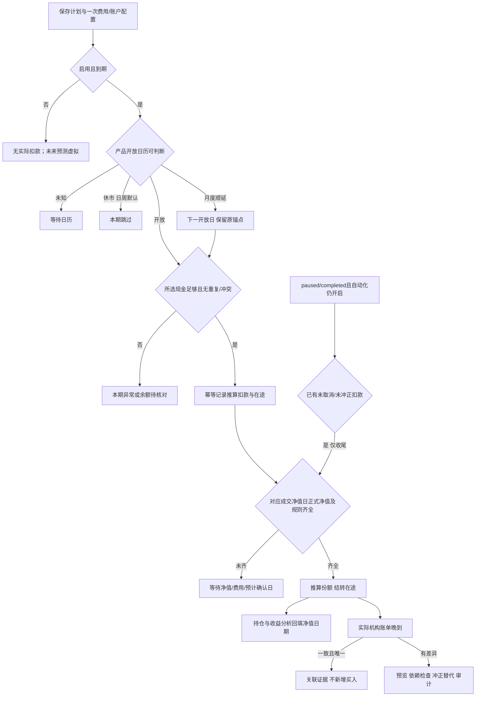

# 财务管理系统：领域模型与核算边界

维护日期：2026-10-10。第12–17章是现行业务规则与代码差异的唯一维护位置；第1–11章保留开发前领域设计，未映射的概念实体及历史默认值不代表现有数据库或交付。初始审查见[审查基线](audits/system-audit-2026-10-09.md)；2.12.0已完成保数据发布，实际提交、镜像与验证范围见[发布说明](release-2.12.0.md)和[部署证据](audits/evidence/2026-10-10/ux-deployment-results.json)，维护入口为[项目地图](project-map.md)。

## 1. 已确认范围与尚未确认事项

已确认：

- 首版为电脑网页端，从一开始支持多个彼此独立的个人或家庭。
- 同时覆盖境内资产、港美股与外币；不能把人民币或境内市场写成隐含默认规则。
- 首批来源为广发期货、银河期货、喵喵记账、广发基金、易方达基金；包含红利低波产品与 T+2 QDII 场景。
- 需要统一资产视图、账单导入、定投计划与实际执行、投资收益和结算信息。

与 [产品需求](product-requirements.md) 一致的设计默认值（不是用户已确认要求）：个人空间与家庭空间统一为账簿空间；同一用户可加入多个空间；采用 Owner、Editor、Viewer 角色；空间默认本位币为 CNY，首版支持 CNY/HKD/USD，数据模型保留其他币种扩展能力。

尚未确认：具体港美券商、账户所有人及共同持有方式、基金代码与份额类别、产品正式确认规则、五种来源实际导出样本和格式、期货历史结算单覆盖范围、期权市场与产品、收费及税费口径。

“红利低波”是策略或主题标签，不是可用于唯一识别产品的代码；“T+2”是待核实的产品规则描述，不是已知成交日期。产品身份、规则和交易事实分别保存。

## 2. 核心决定

1. 一个业务生命周期只有一个关联组，同一真实阶段只有一个有效主事件。银行记录、记账软件记录等可以成为同一阶段的不同证据；扣款、确认、退款则是关联组内不同的不可变阶段事件，不能因新增证据再次扣款，也不能原地改写已提交扣款。
2. 原始证据、规范化来源记录、经济事项、货币分录、持仓事件、估值快照分层保存，既能追溯，也能重新处理导入错误。
3. 货币账本采用复式记账；证券数量和合约状态采用持仓事件。二者由同一经济事项协调提交，不能相互独立地改变总资产。
4. 机构权益快照与完整细账是同一范围的两种汇总依据。同一账户范围、同一统计时点只能选一个作为资产贡献。
5. 计划和未来预测不进入账本。用户明确启用的自动记账可生成带推算来源的本地扣款/份额；它不是机构已确认交易。第12章替代早期“只有机构实际才可记账”的绝对约定；实际核对仍保留原事实和替代关系。
6. 数据隔离边界是租户账簿；账户所属人与登录用户是不同概念。加入家庭不等于拥有其全部资产。

## 3. 租户、家庭、成员与资产归属

### 3.1 隔离模型

| 对象 | 职责及关键字段 |
|---|---|
| User | 全局登录身份。仅保存身份认证与个人偏好，不直接拥有跨家庭可查询的账目集合 |
| Tenant / Workspace | 一个独立个人或家庭账簿，字段包括 id、名称、报告本位币、默认时区、状态 |
| Membership | user_id、tenant_id、role、邀请/生效/撤销时间；同一用户在不同租户的权限彼此独立 |
| OwnerParty | 资产或债务的经济归属主体，可以是家庭成员、共同持有人等；不要求该主体必须拥有登录账号 |
| AccountOwnership | 账户或资产与 OwnerParty 的归属关系、有效期间、份额与依据；负债的归属不能从资产份额自动推定 |
| ReportingScope | 租户内部统计范围，如全家庭、某成员、特定账户集合；仅缩小可访问范围，不产生跨租户权限 |

个人账簿也使用同一 Tenant 模型，由单个用户成为 owner。首版不区分“个人系统”和“家庭系统”两套数据库逻辑。

所有私有业务实体、后台任务、索引、导出、缓存与对象存储记录必须包含 tenant_id；全局公共产品参考资料与租户自定义资料分开。API 根据已验证 Membership 确定访问范围，不相信客户端传入的 tenant_id 或资源 ID。跨租户外键、批量查询和下载签名都要校验租户一致性。

同一用户在 A、B 两个家庭中出现，不意味着两个家庭之间共享账户、文件、姓名或汇总金额。首版不提供自动跨租户资产合并；如以后增加，只能由明确授权的数据范围组成，并另行处理重复归属。

### 3.2 首版权限建议

| 操作 | owner | editor | viewer |
|---|---|---|---|
| 查看本租户账户、流水、持仓及报表 | 是 | 是 | 是 |
| 创建导入草稿、编辑映射、确认入账 | 是 | 是 | 否 |
| 建立计划、补录事实、对账、提交冲正 | 是 | 是 | 否 |
| 查看导入/核对所需的原始行及定位 | 是 | 是 | 否 |
| 下载整份原始文件 | 是 | 否 | 否 |
| 完整导出账目、报表及配置 | 是 | 否 | 否 |
| 邀请成员、变更角色、设置共享范围 | 是 | 否 | 否 |
| 配置存储保留、密钥及删除整个租户 | 是 | 否 | 否 |

这是与 PRD 对齐的设计默认权限基线，不代表用户已逐项确认。Editor 可以在导入和核对页面查看必要原始行，但不能下载整份原件；Viewer 只读页面。首版同租户成员按角色访问整个租户账簿，不声称已经支持单账户隐私共享。需要对家庭成员隐藏的账户，应留在独立个人租户；在实现账户级访问控制前，不能用界面隐藏代替权限隔离。

至少保留一个有效 owner；成员被撤销后，后台任务、下载链接与会话访问均需重新校验权限。所有确认入账、冲正、归属调整和角色变更写入不可静默覆盖的审计日志。

### 3.3 归属与合并约束

- 一份持仓在同一统计范围只贡献一次；“按账户统计”和“按成员统计”是同一资产的不同切面，不能相加。
- 共同资产可以记录份额，但必须保存份额来源和生效日期；报告同时展示全额与本统计范围应计份额，不能混用。
- 假设一处房产估值 100 万、成员甲经济份额 60%，甲视图贡献 60 万；若甲承担贷款 70 万，负债贡献仍按已确认债务归属记录，不能自动改成 42 万。
- 同一银行账户被误建两次时，先标为待合并账户并阻止双重汇总；用机构、脱敏账号、币种、产品类型及所有人辅助识别，不能仅依赖账户名称。

## 4. 领域实体

| 实体 | 关键字段 | 说明 |
|---|---|---|
| Institution | id、机构名、机构类型、市场/地区 | 广发期货与广发基金是不同机构；名称相似不能合并 |
| FinancialAccount | id、institution_id、脱敏账号、类型、状态、数据范围 | 类型包括银行、现金、支付钱包、基金渠道、券商、期货、贷款等 |
| AccountComponent | account_id、component_kind、currency/instrument、coverage_key | 表达券商现金子账户、证券持仓、期货账户权益等，支持明确的汇总范围 |
| Instrument | id、品种、市场、代码、ISIN（可选）、份额类别、计价币种、时区 | 代码必须结合市场/发行方/份额类别识别；不是一个裸 ticker |
| ContractSpecification | instrument_id、生效期间、乘数、到期/行权等参数、证据来源 | 合约参数从正式资料或结算单验证，不能以品种名称猜测 |
| SourceArtifact | tenant_id、文件哈希、存储键、来源机构、原始名称、加密及保留信息 | 原始证据；敏感字段不进入公开日志 |
| SourceRecord | artifact_id、适配器及格式版本、原始定位、规范字段、来源身份键 | 一条来源证据，可关联经济事项或快照；规范字段不覆盖原文 |
| Operation | id、业务类型、订单/付款关联、生命周期状态 | 一个消费、申购、证券成交交收或还款过程的关联组；不直接产生分录 |
| EconomicEvent | id、operation_id、stage_kind、stage_instance_id、发生/入账/生效日期、币种、状态 | 一个不可变阶段事实，如扣款、份额确认、交收、退款、利息拆分；correlation_id 指向关联组 |
| EventEvidence | event_id、source_record_id、关联类型、审核结果 | 支持一个事件多来源、多事件共用一份汇总结算证据 |
| JournalEntry / Posting | event_id、账户科目、借/贷、decimal 金额、币种、effective_at | 已提交分录不可原地修改；通过冲正及替代事件更正 |
| PositionEvent | event_id、instrument_id、数量变动、成本批次、事件类别 | 买入、卖出、份额确认、分红再投、拆并等；不能把现金金额当数量 |
| Lot / CostPool | instrument_id、account_id、获得日、剩余数量、成本金额/币种、成本与费用政策版本 | 保留真实批次和机构报告成本；管理成本默认移动加权平均，不将其称为税务成本 |
| PriceObservation | instrument_id、价格、币种、price_as_of、published_at、source、kind | 区分正式净值、交易价格、收盘价、盘中估值与手工估值 |
| FxObservation | base/quote 币种、汇率、rate_as_of、published_at、来源、用途 | 交易成交汇率与报表估值汇率分开 |
| ValuationSnapshot | 范围、as_of、observed_at、估值明细、价格/汇率引用、完整度 | 可以重算和版本化；不等于已经发生的现金流 |
| InstitutionStatement / EquitySnapshot | 机构期间、账户范围、权益/余额/保证金等原始字段、定义、证据 | 保留机构语义；相似字段不可直接套用同一公式 |
| CoveragePolicy | scope、期间、mode、起始依据、reconciliation_status | 决定快照或细账哪个参与汇总；禁止重叠的权威覆盖区间 |
| InvestmentPlan / PlanOccurrence | 计划金额/频率、预计日期、状态、关联实际事件 | 计划与实际执行一对多/多对一均可能，允许漏投、部分执行和补投 |
| FundOrderLifecycle | 申请、扣款、交易、净值、确认、份额到账、资金到账事实与状态 | QDII 等延迟确认场景；每一时间字段独立可空 |
| LoanAgreement / Repayment | 合同/余额依据、本金、利息、费用、应付与实际付款 | 还款计划与实际还款分离，利率规则和重定价规则不能靠名称推断 |
| TangibleAsset | 类型、购置成本、所有权、估值来源、估值时点 | 房产等非交易资产；购置成本不等于当前市场价值 |
| Earmark | 对应现金范围、用途、金额/币种、优先级、生效区间 | 预留金是可用资金分配，不是新资产或费用 |
| Reconciliation | 范围、时点、比较项目、容差政策、差异、处理状态 | 详见 import-reconciliation.md |

同一生命周期允许多次部分扣款、部分确认或退款，因此不能简单限制每种 stage_kind 只有一笔。阶段使用稳定 stage_instance_id，在租户和 operation 内唯一；来源原生身份与已审核的匹配关系决定是否同阶段，时间和金额相似仅作候选。新的阶段追加事件，多来源同阶段补证据，更正已有阶段另有冲正／替代链；同一阶段同时只有一个有效版本。

阶段身份与事件版本分开：阶段唯一身份下可留多次历史修订，每次修订指向明确的原事件、冲正和替代事件。账本汇总包含原分录及其反向分录的净额，不能因为原事项在界面已显示“被更正”，就删去它再扣一遍冲正。

## 5. 金额、数量与多币种约束

### 5.1 精度

- 禁止用二进制浮点数存金额、数量、净值、汇率或合约乘数。传输层使用十进制字符串，数据库使用 DECIMAL/NUMERIC 或等价精确表示。
- 建议初始边界：货币金额 DECIMAL(38, 12)，数量/价格/汇率 DECIMAL(38, 18)。这是存储上限建议，必须由真实样本验证后冻结；超精度输入应报错或进入人工确认，不静默截断。
- 展示小数位与存储小数位分开。币种最小单位、机构实际精度、基金份额精度和产品成交精度分别保存；不默认所有金额只有两位小数。
- 原始文本值始终保留。汇总前不逐项随意四舍五入；涉及正式结算的舍入位置和方式采用经验证的机构/产品规则。
- 舍入差额只有在明确规则与容差内才能进入专用差额科目，并保留解释；不能用“自动调平”掩盖漏单。

### 5.2 账本平衡

货币账本每个已提交 JournalEntry 必须按币种借贷相等。跨币种兑换使用显式兑换桥接科目，使每种币种分别平衡，并同时记录真实兑换数量、成交汇率和费用。

例如用户用 7,200 CNY 兑换 1,000 USD，假设无手续费：

| 币种 | 借方 | 贷方 |
|---|---:|---:|
| CNY | 兑换桥接 7,200 | 人民币银行 7,200 |
| USD | 美元银行 1,000 | 兑换桥接 1,000 |

兑换桥接是内部核算科目，不计入资产展示；该交换事件需要保留 7.2 CNY/USD 的真实成交关系。报表换算成其他货币时另用统计时点的汇率，不回写历史成交金额。

证券份额由 PositionEvent 表达。成交和交收分离时，买入成交确认持仓／成本及交收应付款，资金实际交收再冲应付款并减少已交收现金；卖出形成交收应收款并释放持仓，到账再冲应收转现金。确实同时成交交收的产品可在同一阶段完成对应分录，但不能把两阶段各扣一次现金。已交收现金不等于可交易／可提取金额，可用性以机构限制另记；合并净资产需纳入交收债权债务。

持仓数量不作为货币金额再次汇总。单次阶段提交必须保证分录、持仓变动、费用、证据与覆盖校验一致成功或失败。

### 5.3 报告币种与价格时间

- 原币金额永久保留，报告本位币只用于展示与汇总。每个租户独立配置报告币种；改变报告币种不改账本事实。
- 每个换算金额必须可追溯至汇率方向、来源、报价时点、发布时间及换算路径。允许缺失，缺失时标记“无法完整估值”，禁止默认为 1。
- 报表的“截至时间”与行情/净值/汇率的各自时点分别展示，陈旧价格不得伪装成实时资产。
- 历史报表不能使用报告截止日之后才有效的价格。是否允许使用后来公布、但归属报告日的正式基金净值，作为显式的历史重算政策保存。
- 默认不把估值变动直接记为生活收入，也不在已经使用市值的汇总上再次增加“未实现收益”。

## 6. 快照和细账如何共存而不重复

### 6.1 三种核算状态

| 模式 | 资产汇总依据 | 允许的辅助数据 |
|---|---|---|
| institution_snapshot | 指定范围最近有效的机构权益/余额快照 | 交易明细可以用于解释、分类和对账，但不再次贡献该范围净资产 |
| detailed_ledger | 已对齐期初余额/持仓的细账，加适用价格和汇率 | 机构快照仅作为核对依据 |
| pending | 证据不足、范围不明或两者不一致 | 单独显示待确认金额，不声称已核实，也不自动混入可信净资产 |

部分账户可以按明确互斥的子范围使用不同模式，例如“港币现金细账”和“某独立证券子账户快照”。只有机构快照明确不含其他已计入部分时才允许这样拆分；不能凭推测从总权益中减去一个数字来混合汇总。

### 6.2 数值案例：券商/期货机构权益

假设机构声明某账户时点权益 100,000 元，文件同时列出现金 20,000 元和证券市值 80,000 元。快照模式下资产贡献是 100,000 元，现金与证券只是解释明细，不能再加一次形成 200,000 元。

若某期货文件列权益 100,000 元、保证金占用 30,000 元、可用资金 70,000 元，且正式字段定义明确后两项是权益的构成，则资产仍为 100,000 元。合约名义金额和保证金不额外相加。真实结算单可能有冻结、质押、权利金等项目；只有验证公式后才按该式解释。

### 6.3 快照之后的已知出入金

旧快照与新银行余额直接相加可能制造虚假的资产减少。快照模式可采用一条有明确标记的资金滚动投影：`旧权益 + 快照之后已证实到账的外部入金 − 已证实的外部出金`。这是同一覆盖范围的单一投影，不是再加整套细账；未反映的新交易盈亏、估值、费用使它必须标记为“暂估／不完整”，不能称为最新机构权益。

银行出金已证实、收款端尚未证实到账时，使用明确的转账在途，不猜已入期货账户。收款确认后，在途转为该账户的滚动调整；同一资金事件不能同时留在在途、滚动调整和独立现金组件中。

新快照到达后，以来源期间、账户范围和出入金证据确定哪些调整已被包含；只吸收这些调整，并将其从投影中移除，不能凭上传先后顺序处理。无法确定包含关系时进入覆盖冲突，不发布完整当前净资产；可以看最近共同已核对时点和带缺口标记的局部值。

示例：银行 50,000，期货旧权益 100,000，银行转出 10,000。未确认收款时为银行 40,000＋转账在途 10,000＋旧权益 100,000；确认到账后为银行 40,000＋暂估期货权益 110,000，总计仍为暂估 150,000。新机构权益 111,500 明确包含该入金后，替换投影，银行加期货为 151,500；不再额外加 10,000。这里未假设快照间没有行情变化。

### 6.4 从快照切换到细账

1. 选择明确的切换时点与账户范围。
2. 取得该时点的现金、持仓、负债和机构权益证据，建立期初事实，标识其不是当期收入或收益。
3. 导入切换后的全部必要事件，并与后续机构结算结果核对。
4. 差异已处理后启用 detailed_ledger；之前的快照仍留作历史证据。
5. 用 CoveragePolicy 确保一个时点只有一个权威模式。缺失历史成本时可以准确展示当前资产，但不能宣称历史收益已完整重建。

## 7. 投资事件、计划与收益

### 7.1 定投状态

计划发生项可处于 scheduled、submitted、partially_executed、executed、failed、skipped、cancelled。仅有计划或扣款提醒不形成正式账本。一次计划可以对应多次实际扣款，一次实际汇总扣款也可以分摊给多个计划；分摊不复制实际金额。

首版收益交付为收益分项与 XIRR 类资金加权年化回报：分别展示累计投入/取回、现金分红、费用、已实现盈亏、未实现盈亏和汇率影响；预测结果独立展示。不同指标分别保存定义和计算版本，不能统一叫“收益率”。

资金加权年化回报需要真实现金流日期、明确组合范围及截止日终值；组合内转账不是整个组合的外部现金流。资料缺失、现金流无可用解或多解时返回明确状态，不展示伪精确数字。模型为时间加权回报（TWR）保留估值与外部现金流分段数据，但其计算与界面不属于首版交付要求；后续实现须先确认数据完整性。

数值案例：两次定投各 1,000 元，截止日市值 2,100 元，无赎回、分红和其他费用时，金额收益为 100 元。5% 只是相对累计投入的简单比值；投入日期不同，不能把它直接标为年化收益率。

### 7.2 基金和 QDII 生命周期

单独保存 submitted_at（申请）、debit_at（扣款）、trade_date（交易归属日）、nav_date（适用净值日）、nav_published_at（净值发布时间）、confirmed_at（确认）、units_available_at（份额可用）、cash_settled_at（资金到账）及各字段来源。

这些字段可以只有日期、也可以有精确时间。应另存日期精度和时区，不能给只有日期的原文伪造“00:00 成交”。

T+2 必须有规则版本、市场日历、申请截止时间、节假日和特殊暂停等正式依据。首版以实际确认单和到账流水为事实，不硬编码“两个自然日”或统一“两个工作日”。规则尚未验证时只展示机构提供的预计日期，或标为未知。

申购在途应计入一次资产；确认后的份额替代在途。示意：扣款 1,000 元时，现金减少 1,000、申购在途增加 1,000；后来确认份额价值按成本为 995 元，手续费 5 元，在途清零、基金成本增加 995、费用增加 5，持仓事件登记实际份额。是否将费用计入成本需要显式会计政策；本例采用费用单列，不能据此推定真实产品费率或份额。

赎回同样区分申请、份额扣减、应收赎回款与实际到账。份额扣减和应收金额未确认时，不根据申请金额虚构最终成交。

### 7.3 股票、期货、期权边界

- 基金与股票管理成本默认采用移动加权平均：按账户、产品/份额类别和成本币种维护成本池；同时保留真实交易批次与机构报告成本供核对，不将管理成本视为税务成本。成本政策、费用单列/成本化政策及其生效版本必须明确保存，变更需重算受影响期间并保留旧版本。
- 简化示例（费用单列且忽略税费）：先买入 100 份，每份 10 元；再买入 100 份，每份 20 元，成本池为 200 份、3,000 元，平均成本 15 元。随后以每份 18 元卖出 50 份，结转管理成本 750 元，未扣费用的已实现盈亏为 150 元，剩余成本为 2,250 元。真实费用根据显式政策处理，不能既计入成本又作为同一指标的费用重复扣减。
- 股票记录成交、费用、税费、分红、转托管和拆分；复杂公司行动的领域身份可以保留，但其专用核算流程属于后续增强。
- 期货首先保存正式结算单原始字段与账户权益；逐日结算、平仓盈亏、持仓盈亏的含义和期间必须按对应机构文件验证。
- 期权保留合约身份、乘数、权利金、持仓方向、到期、行权和履约证据。首版以机构结算口径导入、展示和对账；自动逐笔复算、行权履约及标的交付核算属于后续逐产品验收范围，不能只从价格涨跌推算账户权益。
- “估值盈亏”与“已入账结算资金”分开；同一结算收益不能既增加现金、又被作为额外资产加总。
- 港美股券商尚未明确，因此本阶段只冻结市场、币种、时区及结算生命周期模型，不承诺具体券商导入、税务报表或自动公司行动处理。

## 8. 贷款、购房与预留金

### 8.1 贷款本金与利息

负债账户保存尚欠本金及其依据。应还计划不等于实际还款；实际支付拆分本金、利息、费用、提前还款等，拆分和总支付必须一致。

示例：一次还款 4,000 元，其中本金 2,500、利息 1,500，现金减少 4,000、贷款负债减少 2,500、利息费用增加 1,500。把 4,000 全记生活支出会夸大支出；把它全冲本金会低估负债。本例只演示账本拆分，实际拆分必须来自还款明细。

仅有一条已证实的 4,000 元银行卡扣款而没有贷款拆分时，先借记“还款待分配清算”4,000、贷记银行 4,000，保留待拆分阶段。该清算项不是可用现金，也不能当作已经确认的真实资产来发布完整净资产；负债、费用与相关收益指标标记不完整，不凭余额比例或历史规律猜本金利息。

后续证据确认本金 2,500、利息 1,500 时，在同一还款关联组追加拆分事件：借记贷款负债 2,500、借记利息费用 1,500、贷记待分配清算 4,000，不再次动银行现金。借贷仍平衡，待拆分状态关闭；原扣款事件保持不变。利息计提、罚息和提前还款规则待合同与实单验证。

### 8.2 购房资产负债

示例：房价 1,000,000 元，首付 300,000 元，新增贷款 700,000 元。完成购置并取得足够证据时，房产成本增加 1,000,000、现金减少 300,000、负债增加 700,000。忽略费用和估值变化时，净资产不会因贷款发放凭空增加。

按揭直接付给卖方与先进入本人账户再付款，现金流水不同，但不能把同一 700,000 元贷款计两次。通过同一融资/购置事项关联银行放款、卖方收款和贷款合同；在途资金使用清算科目。

税费、中介费、装修和其他购置费用采用待确认分类与资本化政策，不在没有事实时统一计入房价。房产成本与市场估值分开，手工估值标注来源、时点和估值范围。

### 8.3 预留金

示例：银行余额 500,000 元，其中 200,000 元为购房预留金，资产仍为 500,000 元；扣除该预留后可自由安排金额为 300,000 元。预留金不是额外存款、不是负债，也不是已经发生的支出。

实际把 200,000 元转至另一张银行卡时，只形成账户间转账；将 Earmark 指向新现金范围即可，不能再扣一次净资产。预留不足时报告缺口，不生成虚构现金。

## 9. 必须成立的核算约束

- 每个已提交分录按币种平衡；所有行属于同一租户。
- 一个主事件的现金、费用、持仓和证据关系原子提交；事件重放不重复生效。
- 资产估值贡献按 coverage_key 互斥，快照与细账不能重叠计入。
- 未来计划/预测不能进入流水或余额；已到期且用户启用的自动记账按第12章记录并注明推算来源，不冒充机构确认。
- 账户转账在同一报告范围内不计为新增收入/支出；跨范围时保留其资金流入/流出性质。
- 退款指向原消费/费用及退款事实，不默认记成新的经营或工资收入。
- 已关闭批次和已提交事件更正必须保留版本、操作者、原因和冲正链。
- 资产数据缺失、价格陈旧、成本不完整和对账未完成均为一等状态，不能只在备注中隐藏。

## 10. 开发前验证清单

| 风险/未知 | 需要的证据或决定 |
|---|---|
| 期货字段公式、两种盈亏口径、保证金和冻结资金含义 | 广发期货与银河期货至少连续两个交易日完整结算样本，包含入出金及交易变动 |
| 基金在途与 T+2 实际流程 | 广发基金、易方达基金的申请/确认/净值/到账完整案例，产品代码与正式规则 |
| 红利低波同名、不同份额类别混淆 | 精确产品代码、份额类别、发行方及交易渠道 |
| 喵喵记账导出语义及重复覆盖范围 | 真实导出、账户/分类/转账/退款/余额字段解释 |
| 港美股时区、币种、清算和公司行动 | 确定券商及实际账单，不以其他市场规则代替 |
| 家庭共同财产与负债归属 | owner 确认统计范围与归属方式，不从姓名或婚姻关系推断 |
| 固定精度边界 | 所有首批样本中的最大金额、净值/份额精度、汇率与乘数 |
| 历史收益可靠性 | 明确可取得的期初持仓成本、外部现金流、分红与价格历史范围 |

## 11. 参考资料及适用范围

- [Beancount 官方投资记账文档](https://beancount.github.io/docs/trading_with_beancount/)：用于参考成本批次、现金、费用与已实现/未实现盈亏的分离方式；不是中国、香港或美国特定机构结算规则的依据。
- [ezBookkeeping 官方功能表](https://ezbookkeeping.mayswind.net/zh_Hans/features/)：用于参考多账户、转账、资产展示和导入能力；其文档未构成本设计中复杂投资核算已经可直接复用的证明。
- 本文数值均为明确简化的系统设计案例，不宣称是任何产品的真实成交、费率或结算周期。

## 12. 现行业务基线（2026-10-09）

本章至第17章是当前定投、日期、收益、估算、数据质量及展示规则的唯一维护位置。初始基线为 `e379dfe67a715d9913af246eba021c7b26ce45d1`；以下已验证修复随2.12.0应用提交 `c99d3b35bc82e38cb52559333a30e7f86e527605` 完成保数据发布，2026-10-10 08:13:25（北京时间）最终验收通过。[审查及修复记录](audits/system-audit-2026-10-09.md)保留各阶段证据，当前部署范围见[2.12发布说明](release-2.12.0.md)；[项目地图](project-map.md)负责定位，[API](api-contract.md)负责字段契约。第1–11章保留早期领域设计，概念实体不能直接当作已存在数据库表。

产品身份：这是个人/家庭资产记账系统。启用自动定投意味着授权系统按计划推算并记录，**不向银行、基金或券商发起支付、扣款或申购**。普通期次无须反复人工确认；后来的机构证据用于核对和更正。行情正式、份额实际、扣款实际是三个独立判断。

| 规则 | 当前事实/目标/未决 |
| --- | --- |
| 普通记账事实可追溯、隔离、按币种平衡 | 已实现并在 runtime 角色回归；普通修改使用冲正/替代 |
| 新场外基金定投一次设置后自动推进 | 已实现；旧显式关闭及缺配置计划不自动开启。还需对应日历、资金和费用等条件 |
| 自动记录的扣款和份额标注推算 | 已实现；正式净值不是机构交易成功证据 |
| 净值/确认晚到回填分析日期，不移动原流水 | AUD-003已修复：标准账单保留有据nav_date；缺失不猜。旧已处理账单不自动重解析 |
| 机构实际证据使有效份额来源升级 | AUD-002已修复：日收益/日历批量读取有效完整确认证据；撤销后恢复推算，原payload不变 |
| 已停止新期次，已扣款期次继续收尾 | paused/completed可结清已扣期；completed不生成新期次，显式off及取消/冲正保持阻断（AUD-001） |
| 时间戳/业务时区统一 | 目标；server、browser 和 space 的“今天”存在不同实现，R-001 待跨时区交互验证 |

### 12.1 不同维度的状态

| 维度 | 当前载体 | 解释 |
| --- | --- | --- |
| 计划是否继续 | Resource(kind=plans).data.status；automation.enabled/start_date/excluded_dates/pause_ranges | active/paused/completed/archived/draft；结束生成、暂停和关闭自动化不能等同于退款 |
| 到期意图 | Occurrence.due_date/sequence/status/details.scheduled_date/plan_version/event | confirmed 是已关联本地事件，并不自动代表机构确认 |
| 执行进度 | Occurrence.details.automation.status；processing_state | waiting/attention/complete/inactive；不能用一个“待确认”同时表达净值缺失与交易证据缺失 |
| 资金 | JournalLine cash/fund_transit/receivable/payable | 已记扣款→在途→份额/退款；赎回确认→应收→到账，不能跨阶段再扣或再算收益 |
| 来源核实 | Event.payload.automatic_estimate/entry_basis；active EvidenceLink；fund_reconciliation.event_evidence | 原 payload 不可变；有效来源应根据仍有效的证据关系解释 |
| 行情质量 | Price.kind/economic_date/published_at；market_quotes.data_quality/nav_quarantine | 正式/参考、单源/一致/冲突、公布/获取不是同一维度 |

不新增与上述同义的一套状态表。未来若需要补充字段，优先扩展已存在的版本化 Resource/证据信息，只有明确使用与约束才新增数据库列。

### 12.2 当前流程与最小目标流程

修复阶段已补三个断点：停止新增与已扣期结清分开（AUD-001）；标准账单成交日及有效份额证据进入收益读侧（AUD-002/003）；同条件检查不制造账务修订，进度API/页面显示最近实际检查时间（AUD-005）。`last_checked_at`只证明计划检查发生，不证明worker/beat持续健康；退避、超期提醒和调度失联出口仍是OD-06/R-005待办。

### 12.3 每种等待/暂停的闭环

当前后台 scan_all 每300秒；开发 tick 在一轮结束后等待约30秒。每次计划最多处理500期，游标轮转。等待可重复检查，但**没有按等待原因持久化的退避、截止时间或超期升级策略**。表中“目标超时”是维护要求，尚未实现，不能写成现有行为。

| 状态 | 进入条件/影响阶段 | 自动唤醒与当前重试 | 目标超时与人工条件 | 退出 |
| --- | --- | --- | --- | --- |
| scheduled | 到期，尚未检查 | 周期扫描、保存、显式 run | 调度滞后先排任务，不能让用户确认每期 | waiting_* / recorded_* / excluded |
| configuration_required | 旧计划没有一次自动配置 | 补计划设置后保存/扫描；不会擅自开启 | 用户选择启用，或保持关闭；不生成每天确认任务 | scheduled / disabled |
| waiting_calendar | 开放日未知，或确认规则无法算日；判开放前不扣，已扣后的确认日未知仅等份额 | 日历/产品规则维护后的扫描 | 规则已无覆盖或不明需要一次核实；未知年度不得按周末猜 | 正常扣款/等待净值/确认 |
| waiting_cash | 所选账簿可用现金不足或被冻结 | 补期初/实际入金/解除适用冻结后扫描 | 区分真实不足与账簿资料缺口；只处理本期，不找其他卡、不赎回货币基金 | 扣款后 waiting_* |
| waiting_nav | 精确成交净值日正式正数净值未到 | 行情入库后后续扫描；正式净值不依赖估值 | 依据该产品正常披露周期标超期；接口中断运维处理，不能改用最新/下一条 | waiting_confirmation / recorded_estimate |
| waiting_confirmation | 尚未到参考确认日期 | 日期到达后的扫描 | 预计确认不等于机构已确认；真实渠道延期可补证，不自动判断失败 | recorded_estimate / needs_review |
| waiting_fee | 扣款已记、费率未知，份额无法可靠推算 | 一次费用配置保存后重跑 | 当前为 attention、action_scope=plan；不是逐期审批；不能未知填零 | recorded_estimate |
| needs_review | 已知净值冲突、候选交易/部分确认/退款/撤销或配置与已扣事实不符 | 冲突一致恢复可扫描；实际核对/修订后扫描 | 真冲突需要证据，不因只剩一个来源抹掉；修改资金/产品等需明确范围 | already_recorded / recorded_estimate / excluded |
| disabled | 用户关闭自动化 | 不自动唤醒 | 尊重关闭；如何继续已扣期次应按授权明确，不新增默认值重开 | 用户明确启用或按实际记录完成 |
| paused | 停止新扣款；已扣期次可继续确认 | 已扣阶段仍在扫描；恢复后再生成到期期次 | 恢复是否补过去期次由生效日期/排除规则决定，需在页面说明 | active 或旧期次完成 |
| excluded / skipped / cancelled | 明确跳过/排除/取消 | 不自动重建同笔扣款 | 扣款以后跳过不等于退款；先核对既有阶段 | 保留历史，实际退款另记 |
| completed | 停止生成新期次/新扣款；保留原已扣期次 | automation.enabled为true时周期扫描已扣阶段；精确NAV/规则到齐后收尾 | off、排除/取消、扣款冲正或事实配置冲突仍不自动推进；不能靠改active解锁 | 原期次完成；计划保持completed |
| archived / draft | 当前run_plan不处理 | 不自动唤醒 | 归档、草稿不等于完成；需要独立有据处理，不能一并重启 | 保留历史或关联实际记录 |

同一配置、排期和状态内容不变时不提高账簿修订/Occurrence版本；`generate_schedule`仅在生成字段相同的到期DCA保留automation进度（AUD-005已修复）。实际金额/配置/排期变化仍使预览失效；最近检查更新在runtime，不当账务变动。

### 12.4 计划日期、规则生效与幂等

- 日/周默认休市跳过；月默认顺延到已知下一开放日。每期从最初 start_date 和 index 计算，月末 clamp 不用上期顺延日作新锚点。原自然锚点存 details.scheduled_date，实际执行日存 due_date。
- 月末日期、长假与跨市场由 subscription_rule 决定；境内定投申请日不能被纽约时差提前一日。CN_EXCHANGE 覆盖2025/2026，CN_FUTURES/HKEX/US_EQUITIES 覆盖2026；范围外返回 unknown。产品临时暂停/限购需排除或实际证据，交易所年历不代表所有产品开放日。
- 到期 DCA 才持久化 Occurrence；30/90/365天 forecast 调用虚拟排期，不创建未来扣款/交易。历史补录使用独立预览/实际证据入口；从今日自动开始用 automation.start_date。创建时间不是历史扣款日期。
- 基线阶段标识：`{space}:dca:{plan}:{原计划锚点}:debit|confirm`。月度顺延不改标识；数据库 stage_key 唯一、Occurrence(plan,sequence) 唯一、空间写锁和事务共同保护。HTTP 幂等与永久来源身份职责不同。
- 已执行引用事实不随配置修改重写；当日未执行意图可以调整，旧待处理事实与当前账户/产品不符则需核对。**待决策 OD-02**：金额/费用/产品规则变更的明确生效范围及规则版本；尤其区分“补全原未知费用”和“对未来改费率”。

## 13. 日期字典与份额资格

| 概念 | 当前位置/用途 | 不能替代什么 |
| --- | --- | --- |
| 计划自然到期锚点 | plans.start_date + frequency；Occurrence.details.scheduled_date | 创建时间、顺延后的实际日 |
| 执行/申请开放日 | Occurrence.due_date；fund order 的 trade_date/交易日预览 | 不是所有基金统一 T+1/T+2 的证明 |
| 申请时间 | fund-orders Resource 的 application_at；trading_calendar.preview_trade_dates | 有时区时间按市场解释；只有日期不补秒 |
| 扣款日 | fund_debit Event.economic_date；账单 payment_date | 不随收益重算改成净值日 |
| 成交净值日 | fund_confirm.payload.nav_date、自动期次 nav_date；标准账单normalized.nav_date（选填） | 不是确认、公布或获取日；未知保持null |
| 份额确认日 | fund_confirm Event.economic_date / confirmation_date | 机构实际与系统预计来源分别注明 |
| 赎回确认/到账日 | fund_redeem / related settlement Event.economic_date | 应收与现金分别发生，不再算一次投资收益 |
| 净值归属日 | Price.economic_date | 净值被看到的时间 |
| 收益归属日/期间 | ReturnEvidence 与 _calendar_item 返回 return_date/date/interval_start | 不是持仓最新更新时间 |
| 数据公布时间 | Price.published_at；报价 published_at | 未知留null；统一available_prices排除未来公布观察，到时可读，不改原Price（AUD-006） |
| 系统获取时间 | market_quotes.fetched_at；Price.created_at/observed_at | 不能补造公布时间或让旧估值变“今日实时”（AUD-004） |
| 记录创建时间 | TenantModel.created_at、ResourceRevision/Audit | 只说明何时记录，不证明何时交易 |

当前业务“今天”分散在 planning.today(space)、common.day/timezone.localdate(server) 与前端 dateToday(browser)；目标按空间/产品/账户适用时区统一解释，带偏移时间存实际时刻。R-001 暂未完成异地浏览器全路径验证，不能仅用服务器设置上海宣称统一。

`return_dates.analytical_movement` 是只读分析：有匹配原扣款且 debit_date ≤ nav_date ≤ confirmation_date，并且确认事实已可知时，将场外 fund_confirm 的份额与成本分析生效日期映射到 nav_date。原持仓可用日、资金在途和 Event.economic_date 不改。缺/无效 nav_date 不猜，沿用实际记录并说明不足。场内产品不套用该回填规则。

标准核对的nav_date由原列显式提供：不得在未来，不能早于已提供申请日（缺申请日则以扣款日为下界），不能晚于确认日。NAV日与现有确认不同，即使金额/份额一致也需差异预览和有原因的冲正替代；缺字段不继承旧日期冒充实际证据。申请日早于扣款日的产品，读侧上述扣款下界的适用性仍需产品依据核验，不扩大本轮合成规则。

普通净值型场外基金：当日涨幅由此前有效份额享有；以当日净值买入的新份额通过同时扣除本次取得成本消除成交前涨幅，下一净值期间起参与。这不是普适的分红/货币基金/场内规则。

| 产品 | 本系统范围与依据边界 |
| --- | --- |
| 普通净值型场外基金 | 精确成交净值日/费用/确认规则；参考 T+1 标为 estimated，实际渠道规则优先 |
| QDII | 申请开放日历与估值/正式披露节奏分开；支持明确中美/中港共同开放日，但不能把所有QDII写成同一T+2 |
| 货币基金 | 不按单位净值自动定投/估价；万份收益、起息分配和赎回规则需产品依据；实际收益可记 |
| 场内基金/ETF | 按成交/市场价格、交收、费用与市场日历；不把场外申购 NAV 回填到场内成交 |

多日净值：若中间应披露而缺失，单日收益为空；若产品本就不每日披露，应有该产品的明确期间依据后展示“区间收益”。不能凭后来两条价格均摊中间日期，不能将多日变化命名为“今日”。当前 QDII 缺明确披露规则的多日正式变化保守不算单日；保留最近净值和缺口。

## 14. 指标字典、估算与缺失

2026-10-13：本节新增规则对应 **2.14.1 候选实现**，最终回归与部署状态见[开发状态](development-status.md)。生产最后只读核实为2026-10-13 12:45:55（北京时间）的2.14.0，schema0015，不以本节更新证明已部署。日期归属和原始账务不变量不变。

所有金额/份额/费率均用 Decimal/NUMERIC 和字符串 API；仅显示格式化或图形坐标可转 Number。基金取得成本含申购费，日收益已经从资本变动扣除该成本；不得再从同一收益扣一次。当前自动 gross/(1+rate) 计算净申购额，费用金额按0.01 HALF_UP，份额按明确 precision（缺省2），尾差须在受控范围。实际费率、份额精度和舍入以产品/渠道依据验证，参考默认不能当机构规则。

| 指标 | 计算与范围 | 日期/来源/更新 | 缺失与精度 |
| --- | --- | --- | --- |
| 最近净值收益 | 单资产有效期末市值−期初市值−持仓净资本变动+实际分红净收入；基金费已进入资本成本 | 实际 return_date/nav_date，不进入其他日期“今日总额”；正式Price +有效份额 | 无连续基准/份额/分红依据则null；份额推算要注明；Decimal |
| 今日估算收益 | 同一收益期间的上述式，期末用对应参考绝对估值；仅在日期/基准/新鲜度/适用份额可支持“今日”时 | 估算时间、价格日、期间和来源；同日正式NAV到齐后在收益、持仓和净资产读侧替换对应估值，次日估值不被前日NAV覆盖 | 当前日参考值须已知published_at且年龄0–1200秒，真实fetch不超过600秒；delayed/stale不算今日（AUD-004）。不足null，不造0；产品区间信息仍有缺口 |
| 持有收益/毛浮盈 | 剩余份额×对应估值−剩余管理成本；机构报告值另标日期/范围 | holdings_summary；手工 holding_check 受未变持仓范围约束 | 未知成本只影响成本收益，不抹掉已知份额/市值；费率不重复扣 |
| 持有收益率 | 当前持有收益/剩余取得成本；非年化，不含已卖出部分 | 同上 | 分母≤0或成本不完整则null；不能用日初市值或净投入替换 |
| 原币区间金额收益 | 范围期末价值−期初价值−期间外部投入+外部取回 | reporting.performance 与 _boundary_flow；期初/转账/本金按组合边界处理 | 现金流/价格/覆盖不完整则null；已知部分披露 |
| 日收益率 | 本日收益/(期初市值 + max(本日净正向资本变动,0)) | 当前 _calendar_item/汇总口径；当日费用体现在收益；不是标准TWR承诺 | 分母不足则null；不能复用持有成本分母 |
| 区间日复合收益率 | 有完整单日序列时 ∏(1+r_day)−1 | 日历 summary；缺一天不能伪造完整区间 | 标明所覆盖期间；与现金流时点/XIRR不同 |
| XIRR | 投资者视角 Σ CF/(1+r)^((date−date0)/365)=0，投入负、取回/终值正 | finance_math.xirr，reporting.performance | 资料缺失、多根/无根、搜索失败有状态；数值求解不改金额事实 |
| 净资产 | 明细现金/在途/应收应付/持仓估值/负债按互斥范围合计并折算；机构权益替代同范围明细 | portfolio._wealth_state/reporting.overview；价格、快照及FX各显真实日 | 不完整总额null，known_net_assets为已知部分；不是投资收益 |
| 可动用/规划后可安排 | 已交收现金/可信可提取额−冻结；再减有效预留中未与冻结重叠部分 | reporting/availability/reservations；显式0与未知区分 | 货币基金/证券市值不自动当现金，资料缺口不得假称银行拒扣 |
| 净资产变化 | 两时点净资产差 | net-worth-comparison.change.includes_cashflows=true | 含补录本金、转账边界、费用和收益；不可当投资收益 |
| 覆盖率 | 当前收益 response 的已覆盖资产条目数/总条目数 | known_count/total_count | **按条目数，不是市值覆盖率**；未知市值下不能编造权重 |

原币收益资格与展示币种折算分别判断：`native_status/native_message`保留折算前结果，`amount`始终为原币；缺少有效汇率时`base_amount=null`、汇总状态仍为缺口，不能填零或假称完整。收益折算仅使用收益日及以前、正数且不超过7个自然日的汇率；首页与收益日历采用相同边界，反向汇率取倒数，未来汇率不可回填当前日。缺汇率不撤销已经可靠算出的原币收益，完整日收益率的分母仍要求对应范围完整。

机构权益的日收益使用同一`ReturnEvidence`观察链：实际总权益差减净外部投入；收入、支出、退款、转账和换汇的账户边界资金变动剔除，股息仍按投资收入处理。日历要求正式结算观察；仅有盘中权益可用于首页估算，不自动升级成正式日历。前后观察之间缺少应有开放日时收益留空，正常休市可连接两个相邻有效交易日；不把多日未取到的变化冒充单日收益。按单产品筛选不得将机构总权益归给某合约，无关账户股息也不得改变原筛选范围。

估算的目标最小证据：产品/份额/币种、绝对估值或与它匹配的估算基准NAV及日期、估算时间、覆盖区间、适用有效份额和来源。当前 Price + market_quotes 不一定提供完整基准/区间元数据（R-004），不要用 GSZZL 强乘另一条最新NAV补数字。人民币计价NAV已含其汇率因素时不再叠加底层汇兑；原币汇总转展示币种另使用该日FX并说明时点。

正式与估算替换按“资产+币种+收益区间”定位，不能覆盖其他日期未完成区间。当前 ReturnEvidence 优先同日正式价格，不把同日估值再相加；最近正式日期是上下文。总额只有所选范围完整才叫完整；部分可算时提供known_amount、缺口和条目覆盖，不用0补无估值/休市/错误。

### 14.1 独立手算与固定样本

以下仅为受控普通净值型基金案例；合成D0=2026-09-28、D1=09-29、D2=09-30、D3=10-01，测试日历故意受控，不代表真实国庆开放。金额不由待测函数生成。

| 案例 | 手算结果 | 执行证据 |
| --- | --- | --- |
| A：已有100份，D0=1，D1=1.01，D3才取得D1 | D1=100×.01=1；D3仅更新数据，无新的1元；原事件不变 | audit invariant case_a，通过 |
| B：旧100份，D1=1.02，D1申购102得100份，D3才确认；D2=1.03 | D1=200×1.02−100×1−102=2；D2=200×.01=2；D2原账簿仍在途102、原确认日在D3 | case_b 无费，通过 |
| B含费：102中费用1.02、新99份 | D1=199×1.02−100−102=.98（价格收益2，费用1.02）；D2=199×.01=1.99 | case_b 含费，通过 |
| 赎回50份：D1=1.02、费.50、D3到账50.50 | D1=51−100+50.50=1.50；D2=.50；D3价格不变收益0，到账不是收益 | redemption_fee，通过 |
| 再投：D1净值1、红利2再投2份，D2=1.01 | D1=2元收益、无银行投入；D2=102×.01=1.02 | reinvestment，通过；并非假设所有基金除息不变 |
| 拆分：100→200份，D1净值.5，D2=.505 | D1=0；D2=200×.005=1；成本不变 | split，通过 |
| 历史中间净值缺失 | D3不能将D0–D3涨幅冒充单日，也不均摊；缺口null | missing_day，通过 |
| 实际确认99份/费1.02，与旧推算100份有差异 | 原推算事件+冲正+替代；现金仍898，无第二扣款；D1=.98、D2=1.99 | actual_share_difference，通过 |
| 实际账单包含nav_date但系统此前只记扣款 | B为D1=2/D2=2，实际确认日在D3，现金只扣一次 | AUD-003原断言及常规修复回归通过；未知日期仍留缺口 |

### 14.2 估值刷新、证据与缺口（2.14.1候选）

- 东方财富基金`quote`操作含盘中数据，公共缓存TTL为60秒；仅正式来源和历史操作仍为600秒。扫描每60秒发现到期项，单产品目标刷新间隔仍为300秒；请求时间为正常节奏锚点，worker真实开始时间独立保留，长队列/无效旧锚点回退到实际尝试时间。锁内重新判断到期与任务租约，避免并发重复提交；用户停用来源、行情或计划不被恢复。
- 缓存命中保留原获取/公布时间。正式NAV与另一来源的估值合并时，估值必须严格匹配类型（reference/estimate/market）、产品、币种、来源、价格日、绝对值、公布时间后，才可使用该子估值自己的`fetched_at`。已存在`state.quote`却无法匹配时返回`quote_metadata_mismatch`，等待匹配的观察和证据更新；不能退回借主quote的fetch续期。旧无quote状态保守保留legacy读取，不伪造新增证据。新的不同tick不能替旧Price刷新证据；`observed_at`（Price分支为入库时刻）不能替代真实获取时间。报价和获取时效仍分别为1200/600秒，不因刷新节奏修复放宽。
- 首页partial明确“已计算部分，非全部收益”，缺口分类与下一步按真实对象定位；正式价格配推算份额明确标记。原币可算但缺折算汇率、无盘中来源、旧报价、缺基准和待核对是不同原因。正式较早日期只作带日期上下文；5只基金在排查时来源缺估值仍属覆盖缺口，不造数字。
- 午休/收盘后的“最新带时间估算”政策仍为EST-003/OD-05待决；不假定所有基金或QDII适用统一交易时段，不直接扩大20分钟阈值。缺口、字段与路由维护见[接口§21](api-contract.md#21-每日收益与持仓展示现行)，回归定位见[审查§12](audits/system-audit-2026-10-09.md#12-2026-10-13-估值与收益一致性修复候选)。

## 15. 净值多源质量与受控恢复

现状 `fund_sources._reconcile`：按同产品、同币种、正式净值、同归属日比较规范 Decimal；最新日有效来源可单独使用。查询报错/不支持币种/未配置付费源不会当同日冲突。正式净值可独立于盘中估值使用。AKShare 与东方财富按同原始发布方计1家；同源渠道价格不同仍是需要解释的差异。

| 情况 | 处理 |
| --- | --- |
| 同代码不同份额/币种/市场 | 先核产品身份；不可拿“相近金额”或删身份核验解决 |
| 不同NAV日、过期响应 | 分日期观察；不要制造同日冲突，晚到旧日不得覆盖新日 |
| 单位/精度差异 | 先按来源单位与公布精度规范；Decimal 1.0=1.00；未知缩放/舍入不能自造容差 |
| 一家可用、其他接口失效 | single_source 可用于相应会计价格；保留不足信息，无全部来源健康门槛 |
| 同原始发布方经多个渠道转载 | independent_source_count按发布方；不能靠同源2渠道解除旧冲突 |
| 同日相同身份真实差异 | 隔离该产品/净值日，保留每个观察和错误；不影响无关产品、计划保存或已知扣款 |
| 旧冲突以后只剩单源 | 隔离继续；不能抹掉已知矛盾 |
| 至少2家独立发布方同日一致 | 当前 updated_quarantine 自动解除相应日；回归已验证 |
| 可信发行方明确更正、其他源长期不更正 | 现状无单独受控恢复命令，可能持续等待；OD-01 为最小改进提案，不宣称已发生生产卡死 |

最小目标恢复路径（**未实现，须独立审查**）：

1. 默认优先级按适用产品的发行方正式公布→授权正式来源→可追溯公共转载；排序只选无冲突观察，不跳过已知矛盾。
2. 仅对指定 Instrument/份额/币种/NAV日操作；给出官方公告/原始记录、修订前后数值、公布日（未知留空）、取得时刻和更正证据摘要。账户私有交易证据只能核交易，不能替代公用NAV。
3. 更正者明确说明哪些旧观察失效，预览受影响价格/收益/待确认期次；有权限的操作者、原因、来源、前后值、范围和修订号进入审计。
4. 自动恢复仍用≥2独立一致；官方单源恢复必须是显式“受控更正”，证据与该产品/日期一一匹配、旧冲突被解释；后一条单源刷新本身没有该权限。
5. 更正只更换适用Price/质量引用并重建投影，不静默改已过账金额/份额。历史推算差异另走核对/修订；不因为第三方无限异常阻塞全部资产。

依据边界：[易方达网上定投规则](https://cdn.efunds.com.cn/eufs/protocols/eFundsOnlineTradeRegularInvestmentBusinessRules.html)支持其渠道的日/周跳过与月顺延安排，不能推广所有机构；[上交所2026休市安排](https://www.sse.com.cn/disclosure/dealinstruc/closed/c/c_20251222_10802510.shtml)用于境内市场年历。产品确认/分红资格需合同、渠道和真实记录；历史研究链接见[trade-dates](research/trade-dates-2.3.md)与[QDII研究](research/fund-qdii-return-dates-2.9.0.md)。

## 16. 变更与历史重算边界

收益分析映射、Projection、行情选择缓存可重建；Event/JournalLine/PositionMovement 和 SourceRecord.raw 是原事实，不能为展示日期改写。历史校正先在隔离副本产生差异预览，列资产/日期/旧新收益/来源/规则版本/缺口与汇总控制；备份数据库+私有文件+配置，固定输入修订/方法版本，幂等分批重算并审计，可回滚投影版本。若必须改真实金额/份额，单独列冲正/替代方案及后续依赖，不能混在重算命令里。

本次已完成2.12保数据部署，没有生产历史重算、事实修订、备份恢复或数据重置；执行要求、验收与回滚见 RUNBOOK 和 development-status。

## 17. 2.12.0 展示与下一步

“等待”表示依赖数据或业务日尚未满足；“待核对”表示已有范围/金额差异需要查明；“数据待补全”表示行情、机构数据或汇率缺口。这三者不可互换。点击状态按原期次或账务事实定位对应账户、产品、交易、计划或实际账单；未知或当前空间不存在的对象明确提示，不猜另一个对象。核对、更正、权限、版本及幂等保护不因提示折叠而变化。

首页投影不仅依赖空间修订和业务日期，也依赖计算及返回结构版本。版本唯一维护于 `reporting.OVERVIEW_CALCULATION_VERSION`，2.12为 `account-equity-v25`，`reporting.overview`及API缓存判断共享该常量。修改收益依据或待办定位字段时必须同时升级版本；旧v24结构缓存只读绕过并实时计算，不删除原投影，不通过 GET 写入缓存，也不为刷新页面修改账务修订。旧缓存保留，后续正常重算形成当前版本投影；`test_overview_projection_version.py`使用真实旧payload验证只读绕过与当前版本缓存可用。

历史列表采用业务日期倒序，只有同日才用创建时间/id稳定顺序。业务日历默认空间业务日及此前29日，未来安排主动切换；这仅改变读侧范围，不表示未来实际扣款。图线、日历格、执行日历和历史事实回放仍按自然或依赖顺序处理。详细字段、接口和定位参数集中在接口契约§25，前端规则集中在business-action/date-ordering，不散落到发布说明作为新业务口径。

娱乐角属于独立展示内容，仅弹窗内临时随机状态，不读写资金、持仓、计划或机构证据，也不形成财务建议；后续新增场景需保持这一隔离。
