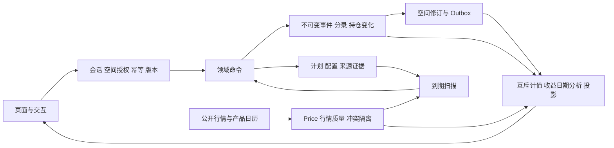

# Wealth 项目地图与维护入口

维护日期：2026-10-13。2.14.2已于2026-10-13 19:34:36（北京时间）部署，应用`71f322456e8f64651bfc6b8d1da6e3599eece586`、schema`0015_chat_remote_controls`。指定定投补足、受限海外参考、实际镜像与验证范围见[最新发布记录](release-2.14.2.md)。初始审查基线`e379dfe67a715d9913af246eba021c7b26ce45d1`及2.14.1历史记录保留；后续状态见[开发状态](development-status.md)。
本文负责“去哪里查、改哪里、测什么”；业务定义只维护在下面列出的唯一位置。覆盖和运行结果见[本次审查](audits/system-audit-2026-10-09.md)，不能从文件存在或测试数量推断已部署。

2.12.0 的展示定位、日期倒序、表单默认值和独立娱乐角已于 2026-10-10 保数据发布，08:13:25（北京时间）最终验收通过；对应镜像、回归及运行范围见[发布说明](release-2.12.0.md)和[部署证据](audits/evidence/2026-10-10/ux-deployment-results.json)。只读接口维护在[api-contract§25](api-contract.md#25-2120只读展示与处理定位)，操作和验收维护在[RUNBOOK§8.6](RUNBOOK.md#86-2120-定位与保数据发布)。这批不新增账务事实、资产类型或迁移，未执行历史重算或数据修复。

## 文档职责

| 问题 | 唯一维护位置 | 说明 |
| --- | --- | --- |
| 产品范围、原始需求 | [requirements-v2](requirements-v2.md)、[product-requirements](product-requirements.md) | V2 和早期产品材料保留历史；本轮明确的自动记账方向见领域模型现行章 |
| 账务不变量、定投状态、日期、收益、估算、数据质量 | [domain-model](domain-model.md#12-现行业务基线2026-10-09) | 当前实现、目标行为、待决策分列；不要从版本发布说明拼当前规则 |
| 请求、响应、权限、幂等、分页 | [api-contract](api-contract.md) | 以函数视图为准；没有已验证的自动 OpenAPI |
| 导入、证据归并、核对和更正 | [import-reconciliation](import-reconciliation.md#15-标准基金核对的现行边界2026-10-09) | 通用格式与机构原生兼容分开 |
| 问题、修复批次、状态 | [development-status](development-status.md) | AUD/EST 为稳定问题编号，R 为未复现风险；修复不能仅关闭文档条目 |
| 产品依据、待定政策、真实样本 | [open-decisions](open-decisions.md) | 保留 D01–D11；新增 OD 编号；负责人未知留“待指定” |
| 排障、安全重试、重算、回归、回滚 | [RUNBOOK](RUNBOOK.md#8-定投与收益维护基线2026-10-09) | 初始审查使用隔离环境；2.12保数据部署已获授权并完成，生产恢复和历史修订仍需具体授权 |
| 场景与放行 | [delivery-and-acceptance](delivery-and-acceptance.md#8-2026-10-09-验收场景与持续回归)、[browser-verification](browser-verification.md) | 历史 G0/A/AT 是验收编号，不代表本轮全组通过 |
| 历史决策、部署 | [ADR](adr/0001-implementation-baseline.md)、[server-deployment](server-deployment.md)、release-* | 保留当时真实性；当前运行版本单独核实 |

原工作区未跟踪的2.8操作手册只读核对并保留；它没有后续Owner代管授权和标准基金核对更新，作为历史参考，不复制到审查分支或作为现行权限依据。

## 真实结构与调用链

- `frontend/src/App.tsx`、`navigation-model.ts`、`navigation.tsx`：路由、现有六个一级模块和个人导航偏好；隐藏不是权限。
- `frontend/src/api.ts`、`state.tsx`、`components.tsx`：同源会话/CSRF、写入幂等、空间请求、资源表单。前端只做输入与展示，图表的 Number 不得回写账务。
- `backend/config/urls.py` → `wealth/views.py:api/dispatch_space`：统一 API。当前服务函数位于 `backend/wealth/*.py`，没有另一个 services 目录。
- `common.py:tenant_context/get_obj/dec/bump`：空间范围、Decimal、审计和修订/outbox。
- `ledger.py:post_event/reverse_event`：唯一普通金融事实写入底座；持仓补录、基金、交易、导入和管理更正调用它。
- `models.py`、`migrations/0002–0006`：NUMERIC、阶段唯一、复合租户外键、RLS、逐币种平衡和不可变/关闭事实。
- `tasks.py`、`config/settings.py:CELERY_BEAT_SCHEDULE`：扫描、行情、分红、投影与 outbox。开发模式另由 `scripts/local_dev.py:supervise` 调用 `management/commands/tick.py`。
- 行情网络位于 `market_data.py/fund_sources.py/akshare_provider.py`，`market_sync.py:refresh_one` 在外部调用前后分事务验证身份，不能把网络等待搬回空间写锁内。



## 功能—页面—接口—服务—数据—任务—测试

接口均省略 `/api/v1/spaces/{s}`；平台接口另标。下表是维护定位，不表示每个页面已做交互验证。

| 功能与实际入口 | 页面 | 接口 | 核心服务/函数 | 数据及任务 | 现有回归 |
| --- | --- | --- | --- | --- | --- |
| 首页、净资产、可用资金、待办 | Home / DailyReturnCard / NetWorthComparison | overview / net-worth-comparison / holdings / signals | reporting.overview、portfolio._wealth_state/net_worth_comparison、daily_returns.daily_return_overview | Event/JournalLine/PositionMovement/Snapshot/Price/FxRate/Resource；recompute | test_reporting、test_overview_projection_version、test_portfolio、test_daily_returns_v263、test_empty_returns_v290、test_pending_purchases_v265 |
| 账户、现金与负债、期初 | Assets / AccountOpeningDate | accounts、accounts/{id}/opening-date、profile | account_opening.initialize_account/correct_opening_date、account_balances.account_balance_projection、recording_coverage | Account/Event/Snapshot/Resource；Outbox | test_account_opening_v24、test_account_opening_edit_v255、test_account_balances、test_empty_account_defaults |
| 产品身份、已有持仓补录 | InvestmentWorkspace / ProductIdentity / HoldingManagement | market/resolve、instruments、holdings | instrument_metadata、metadata_service、investments.record_holding、institution_funding.prepare_holding_funding/transfer_holding_shortfall | Instrument、opening Event/PositionMovement、holding_checks Resource；行情刷新 | test_instrument_metadata、test_metadata_api_v23、test_institution_funding_v25、test_holding_checks_v251 |
| 买卖、转换、在途 | Cashbook → 投资交易；持仓行内操作；FundBuy/FundConvert/HoldingTrade | investment-trades、fund-orders/defaults、fund-orders、fund-orders/{id}/transition、fund-orders/convert | investment_trades.record_trade、fund_orders.save_order/estimate/transition/convert_fund、pending_purchases.PendingPurchases、ledger | Resource、Event、JournalLine、PositionMovement；scan_orders | test_fund_orders_v270、test_investments_v3、test_pending_purchases_v265 |
| 自动定投、历史定投 | 持仓行内“定投”；持仓更多→全部定投；Investments / DcaPlanManager / DcaHistoryImport | plans、plans/{id}/automation、automation/run、history-import | planning.save_resource/generate_schedule、dca_automation.run_plan/_process、dca_history、dca_import、dca_schedule.prune_future_occurrences | Resource/ResourceRevision/Occurrence/Event；scan_all，每300秒 | test_dca_top_up_v2142、audit_scenarios.probes dca-top-up-concurrency、test_dca_automation_v264、test_dca_once_v280、test_dca_due_schedule、test_dca_history_v252、test_dca_import_v253 |
| 流水、消费、收入、转账、退款、预算 | Cashbook | events、events/{id}/reverse、budgets | ledger.post_event/reverse_event、planning.save_resource | Event/JournalLine/Resource；Outbox | test_ledger、test_api、test_final_acceptance、test_finance_math |
| 导入、重复证据、基金核对 | Cashbook → 账单中心；FundReconciliation / DcaHistoryPreview | imports、mapping/preview/commit/reverse、fund-preview/fund-apply、fund-reconciliation/settings | imports.create_batch/preview/commit_batch、fund_reconciliation.preview/apply/_correct/_attach | ImportBatch/SourceRecord/SourceFact/EvidenceLink、私有文件、Event；Outbox | test_import_files、test_fund_reconciliation_v210、test_dca_import_matching_v264 |
| 分红与再投、拆分 | Cashbook → 基金分红；Dividends | dividends/*、events | dividends 发现/候选/确认、ledger dividend/reinvest/split | Resource notices/candidates、Event/PositionMovement；每小时发现，仅确认记账 | test_dividends_v24、test_final_acceptance、audit_scenarios |
| 期货机构权益、期权参考 | Assets；Analytics → 行情与结算；OptionHoldingFields | snapshots、option-holdings、positions、holdings | portfolio._institution_value、availability.institution_availability、option_positions | Snapshot/Resource/Price；合同价格不代替权益 | test_valuation_basis_v25、test_option_positions_v251、test_futures_availability_v261 |
| 财富目标、互斥方案、预留 | Planning → 目标与方案 | goals/scenarios/reservations/strategies、forecast | planning.save_resource/_check_reservations/forecast、reservations.sync_reservation_payments、finance_math.available_cash | Resource/ResourceRevision；预测不生成事实 | test_planning、test_final_acceptance、test_finance_math |
| 贷款、月末还款、周期收支 | Planning → 现金流与还款；Cashbook → 待办 | loans/plans/occurrences/installments、events repayment/repayment_allocate | finance_math.loan_schedule/add_months、planning.generate_schedule/confirm_occurrence、ledger | Resource/Occurrence/JournalLine；scan_all 标到期，实单另关联 | test_finance_math、test_planning、test_jobs、test_ledger |
| 投资手札、版本与附件 | Notebook | notes、notes/{id} 的附件路径 | planning.save_resource/_remember、views.note_attachment | Resource/ResourceRevision、私有文件 | test_import_files、test_security、test_management_v24 |
| 收益日历、分析、配置、标签、提醒 | Analytics / ProfitCalendar / Portfolio / MarketEnvironment | profit-calendar、performance、portfolio-analysis、tag-series、investment-tags、signal-rules、market-watchlist | return_dates.analytical_movement、daily_returns.ReturnEvidence、investments._calendar_item、reporting.performance、portfolio、insights.evaluate_rules | Price/FxRate/Snapshot/事实；signals 每300秒 | test_qdii_returns_v290、test_fund_dates_v280、test_portfolio、test_insights_v22 |
| 行情、公开目录、多源、Token | Analytics → 自动行情；MarketSearch / QuoteQualityDetails；Admin → 数据源 | market/quotes/refresh/history/catalog、/admin/data-sources | market_data.fetch_quote、fund_sources.compare_quote/compare_history/_reconcile、market_quality.updated_quarantine、market_sync.refresh_one、provider_policy/credentials、akshare_provider | Price/market_quotes Resource；MarketSymbol、PlatformSetting；刷新300秒，目录每日 | test_market_*、test_fund_sources_v2100、test_market_quality_v210、test_provider_*、test_akshare_* |
| 普通用户管理、邀请、导出、空间隔离 | Settings / AdminAccessSettings | /auth/*、members/invitations/admin-access、exports/download | views.api/members/exports、workspace_management、admin_access.update_access | User/Membership/Invitation/Resource/Audit；每次授权 | test_security、test_admin_access_consent、test_workspace_usability_v262 |
| 独立管理台、授权代管、删除恢复 | AdminConsole / AdminDataManagement / AdminTemplates | /admin/*；administration/* | platform_admin、admin_access.require_delegation、administration_data、administration_purge、platform_cleanup、catalog_lifecycle、holding_corrections | 平台审计与受限数据库函数；0010/0011/0012；私有文件清理 | test_administration_v25、test_admin_*、test_catalog_delete_v255、test_admin_access_consent |
| 启动、备份、迁移、发布 | scripts / Dockerfile / compose / CI | health；运维命令 | local_dev、backup、test_restore_local、verify_deployment | PostgreSQL/RabbitMQ/私有文件/调度卷；不同环境分别验证 | scripts/test_backup.py、test_jobs；恢复/生产见历史报告 |

函数名调整时先核对源码，表格不替代 API 契约。

## 事实、观察、投影与缓存

| 层 | 权威与修改方式 |
| --- | --- |
| Event / JournalLine / PositionMovement | 普通业务不可变事实，包括有明确推算来源的自动记账；金额或份额改变使用冲正/替代，禁止 update/delete |
| SourceRecord.raw / 私有原文件、SourceFact | 原始来源与永久记录身份；未知字段不填零，同额同日仅候选 |
| EvidenceLink、核对与替代 Resource | 证据关系/归并决策可撤销、版本化并审计；不改原推算 payload 来冒充机构确认 |
| Price / FxRate / Snapshot | 有来源和归属日的观察；行政更正以 superseded/deleted 标记加替代记录；不改原流水 |
| Resource / ResourceRevision / Occurrence | 计划、配置和进度；已执行期次引用事实，不能随新计划静默重写 |
| Projection / Outbox / market_quotes | 可重建结果、持久任务、刷新状态；重建绑定修订号，旧任务不能覆盖新修订。overview结构版本唯一维护于reporting.OVERVIEW_CALCULATION_VERSION；2.14.2为account-equity-v27；2.14.1为account-equity-v26，GET只读绕过旧结构缓存；2.12的v25为历史版本 |
| provider public cache / MarketSymbol | 公开行情缓存与公共身份目录；同源渠道不成为两份独立证据，不缓存私人账户 |

普通查询表与管理 `all_objects` 的差异、RLS 上下文和软删除过滤是维护重点。不要把 JSON Resource 当成随意写入的无约束区。

## 修改影响表

| 修改 | 一起检查的地方 | 最小回归与历史影响 |
| --- | --- | --- |
| 净值选择/冲突恢复 | fund_sources、provider_policy、market_quality、market_sync、reporting.formal_price、ReturnEvidence、holdings、fund_orders、dca_automation、QuoteQualityDetails | 单源/同源/不同日期/真实冲突/身份币种/更正；已有 Price 和隔离需差异预览；不改交易 |
| 收益归属日期/份额资格 | return_dates、investments._calendar_item、daily_returns、profit-calendar、DailyReturnCard、ProfitCalendar、performance | 案例A/B、费率、赎回、分红/拆分、实际核对；重建收益投影，原始经济日期保留 |
| 行情刷新节奏/多源估值身份 | settings、fund_sources._data_cache_ttl、market_sync._refresh_is_due/refresh_due/refresh_one、daily_returns.ReturnEvidence.spot | test_estimate_refresh_cadence、test_estimate_availability_20261013：微偏差、锁内复查、队列失败恢复、禁用、独立fetch和身份/tick不匹配；保留原Price和真实时间 |
| 定投计划/状态/生效配置 | planning、dca_schedule、dca_automation、dca_import、tasks.scan_all、FundOrders、DcaPlanManager、DcaAutomationFields | 到期/月末/假日/未知年历/暂停结束/并发/重启/历史期次；新配置生效范围须明确 |
| 基金账单核对/更正 | fund_reconciliation、imports、SourceFact/EvidenceLink、return_dates、dca_automation、fund_orders、HoldingManagement | 同订单补证、异订单、部分数据、陈旧预览、后续卖出依赖、跨空间；实际金额差异需显式修订 |
| 估算/正式替换/跨币种 | market_data、market_sync、daily_returns、portfolio、reporting、行情/首页/持仓/日历组件 | test_portfolio::test_formal_nav_supersedes_same_day_estimate_in_holdings_and_wealth、test_estimate_availability_20261013；同日替换/次日保留、原币资格、FX边界、子报价身份及时间；估算不生成收益事实 |
| 日历机构权益/资金边界/筛选 | investments.profit_calendar、daily_returns.ReturnEvidence.snapshot/convert、EXTERNAL_FLOWS、ProfitCalendar | test_return_calendar_consistency：首页/日历交叉比较，收入支出退款转账换汇、股息、缺开放日、盘中/正式、无关产品股息筛选、FX日期；只改读投影，不改快照和流水 |
| 收益缺口与下一步展示 | daily-return.ts、business-action.ts、holding-display.ts、DailyReturnCard、HoldingsOverview、QuotesTable、ProfitCalendar | daily-return.test.mjs、holding-display.test.mjs、business-action.test.mjs；partial零值、条目覆盖、原币/折算、正式+推算、未知身份/路由、隐藏金额和实际浏览器点击 |
| 首页计算/待办返回结构/投影版本 | reporting.OVERVIEW_CALCULATION_VERSION、reporting.overview、views的overview缓存判断、tasks重算、Home/business-action | test_overview_projection_version：旧v24/v25/v26 payload只读绕过、v27缓存可用；版本与修订/日期一致才读取缓存，不删除旧Projection或修改原始账务 |
| 期初/机构范围/可用资金 | account_opening、institution_funding、availability、account_balances、portfolio、reporting、reservations | 已有持仓/留存现金/冻结预留/快照去重；保存原期初、修订链和影响预览 |
| 权限/管理/删除/导出 | views、admin_access、platform_admin、administration_data/purge、platform_cleanup、migrations、文件路径 | runtime RLS、跨空间、撤权后重放/下载、所有者、整事件闭包；删除与备份保留策略单独决定 |
| 依赖/迁移/启动/发布 | requirements*.txt/lock、package-lock、Dockerfile、compose、settings、CI、local_dev、backup、database_privileges | 独立库迁移/重复init、runtime角色、私有清理表/函数ACL、不可变/RLS、任务及0012恢复；候选SHA/产物/生产镜像分别核对。授权策略唯一维护在scripts/database_privileges.py（AUD-007） |

重复实现热点：`reporting.overview` 与 `portfolio._wealth_state` 的计值，`ReturnEvidence` 与 holdings 的行情选择，DCA 与 FundOrders 的费用/确认，以及多处版本化 Resource 保存。先补同样本交叉回归，再决定小步提取；本轮不重构账务。

## 常用检查（隔离环境）

已有依赖时，专用审查入口不读取仓库 `.env`，不使用开发主库 55432；新凭证、数据库和私有文件在本机临时目录中按工作区路径隔离，只监听 127.0.0.1。

2026-10-09审计验收结束时已停止专用审查服务并移除临时依赖软链接。原电脑可在审查目录用`/Volumes/mi/Wealth/.venv/bin/python scripts/audit_local.py ...`复查；其他电脑先按锁定依赖准备项目Python环境，下列`.venv/bin/python`表示该环境的解释器。脚本不会自动安装依赖或读取生产凭证；后续隔离验收环境的状态另记于当批证据。

```sh
.venv/bin/python scripts/audit_local.py init
.venv/bin/python scripts/audit_local.py check
.venv/bin/python scripts/audit_local.py test
.venv/bin/python scripts/audit_local.py test audit_scenarios -m audit_invariant
.venv/bin/python scripts/audit_local.py test audit_scenarios -m audit_finding
.venv/bin/python scripts/audit_local.py test tests/test_audit_repairs_20261009.py
.venv/bin/python scripts/audit_local.py probe concurrency
.venv/bin/python scripts/audit_local.py probe restart-prepare
.venv/bin/python scripts/audit_local.py probe restart-recover
.venv/bin/python scripts/audit_local.py probe restart-completed-prepare
.venv/bin/python scripts/audit_local.py probe restart-recover
.venv/bin/python scripts/audit_local.py restore-drill
.venv/bin/python scripts/audit_local.py stop
```

`audit_finding`在初始基线6项失败、修复后6项通过，原预期未弱化。显式审查目录在默认testpaths之外，但[test_audit_repairs_20261009](../backend/tests/test_audit_repairs_20261009.py)已把原6函数及扩展29项纳入默认tests；审计修复阶段默认全量1476项通过。初始红结果和该阶段绿色证据分开，见[审查§8](audits/system-audit-2026-10-09.md#8-授权修复与验收记录)；2.12最终验收另见[发布说明](release-2.12.0.md)。

前端在 `frontend` 目录运行 `npm test`、`npm run typecheck`、`npm run format:check`、`npm run build`。Python 风格用 `ruff format --check backend scripts` 与 `ruff check --select E9,F63,F7,F82 backend scripts`。备份边界用 `python -m unittest discover -s scripts -p 'test_*.py' -v`。数据库模型差异与健康检查见 RUNBOOK；2.12保数据部署已完成，生产恢复、权限修订和历史事实修订不在本次执行范围。

## 维护约定

新增/修改规则时：更新它的唯一文档位置 → 记录 AUD/OD 编号与影响 → 先手算受控样本 → 回归页面/API/服务/数据库/任务 → 记录环境、失败、未覆盖 → 审查数据迁移和回滚 → 发布后另核对运行版本。实现、验证、部署是三种不同状态。


2.14.2新增定位：`backend/wealth/sina_fund_estimate.py`只负责来源报价/基准/时间解析；`fund_return_updates.py`负责严格区间计算与正式结果展示，接入`daily_returns.daily_return_overview`，通过`net-worth-comparison`返回，非overview缓存。`frontend/src/pages/LatestFundUpdates.tsx`及`fund-updates.ts`负责逐项原币/缺数/隐藏展示。回归分别为`test_sina_fund_estimate.py`、`test_fund_return_updates_v2142.py`、`fund-updates.test.mjs`、`reference-estimate.test.mjs`。修改需同时检查API§21.1、领域§14.3、RUNBOOK§8.9；历史Price/Event不在本功能重算范围。

2.14.3后续定位：EST-012“参考失效时最近正式收益被遮住”只涉及`fund_return_updates.py`读侧选择及其固定回归；不迁移数据库、不变更今日聚合。规则仍维护于领域模型/API；发布与转场证据见[2.14.3](release-2.14.3.md)。
